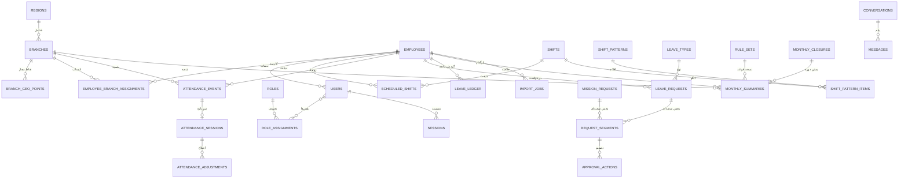

# مدل داده نهایی سامانه رز سفید

| موضوع | شرح |
|---|---|
| سند | تحلیل فاز ۱ ـ مدل داده نهایی (۰٫۱) |
| مبنای طراحی | سند جامع نیازمندی‌ها نسخه ۲٫۱ (مصوب) ـ به‌ویژه بخش‌های ۳، ۴، ۵، ۷ تا ۱۶ |
| وضعیت | آماده بازبینی فنی؛ تثبیت نهایی در فاز ۲ پس از دریافت نمونه Excel و قوانین منابع انسانی |
| تاریخ | آبان ۱۴۰۵ (اکتبر ۲۰۲۶) |
| موتور پایگاه داده | PostgreSQL 16 + PostGIS |

## ۱. اصول طراحی مدل

مدل زیر ترجمه مستقیم تصمیم‌های مصوب سند ۲٫۱ به ساختار داده است. این اصول در همه جدول‌ها رعایت شده‌اند و هر انحراف از آن‌ها در فاز ۲ باید با ثبت در نسخه جدید سند همراه باشد:

1. **بدون حذف نرم در داده‌های حساس:** برای `attendance_events`، `attendance_sessions` و `leave_ledger` ستون `deleted_at` تعریف نمی‌شود؛ حذف فقط از مسیر پاکسازی کنترل‌شده (بخش ۱۵ سند) با ثبت در `cleanup_runs` انجام می‌گیرد.
2. **ارتباط تاریخ‌دار:** انتساب پرسنل به شعبه، تخصیص شیفت و اعتبار قواعد همگی دارای `valid_from` و `valid_to` هستند؛ انتقال بین شعب گزارش تاریخی را تغییر نمی‌دهد.
3. **اصلاح به‌مثابه لایه تصمیم:** رویداد اصلی هرگز بازنویسی نمی‌شود؛ `attendance_adjustments` تصمیم اصلاحی را جداگانه نگه می‌دارد و محاسبات از آخرین تصمیم پیروی می‌کند.
4. **قواعد داده‌ای نسخه‌دار:** تأخیر، تعجیل، استراحت، اضافه‌کاری و تعطیلات در `rule_sets` به‌صورت JSON با تاریخ اعتبار ذخیره می‌شوند، نه در کد ثابت (تصویب نسخه ۲٫۱).
5. **دقت داده زمانی:** همه مقادیر زمانی `TIMESTAMPTZ` و مدت‌ها به‌صورت دقیقه (عدد صحیح) ذخیره می‌شوند؛ نمایش ساعت:دقیقه تنها در لایه گزارش انجام می‌گیرد. ایران از ۱۴۰۱ وقت تابستانی ندارد و آفست ثابت `+03:30` مبنا است.
6. **تفکیک شعبه‌ای خلاصه:** `monthly_summaries` در سطح «پرسنل ـ شعبه ـ ماه» نگهداری می‌شود تا خلاصه کل فرد همیشه از جمع بخش‌ها بازسازی شود.
7. **شناسه‌ها:** کلید اصلی همه جدول‌های عملیاتی `BIGINT` با `IDENTITY` است؛ شناسه رویداد تردد علاوه بر آن `UUID` تولیدشده روی دستگاه را نگه می‌دارد که کلید یکتای همگام‌سازی است.
8. **محدودیت در دیتابیس:** همه قواعد ضروری (یکتایی، شرط مختصات، شرط بازه زمانی) هم در سطح CHECK/UNIQUE دیتابیس و هم در لایه برنامه اعمال می‌شوند.

## ۲. نمودار روابط موجودیت‌ها

## ۳. جدول‌های حوزه سازمانی

### ۳.۱. `regions` ـ مناطق

| ستون | نوع | قید و شرح |
|---|---|---|
| `id` | BIGINT IDENTITY | کلید اصلی |
| `name` | VARCHAR(120) NOT NULL | نام منطقه |
| `code` | VARCHAR(20) NOT NULL UNIQUE | کد یکتا |
| `is_active` | BOOLEAN NOT NULL DEFAULT true | وضعیت |
| `created_at` / `updated_at` | TIMESTAMPTZ NOT NULL DEFAULT now() | زمان‌های سامانه‌ای |

### ۳.۲. `branches` ـ شعب و کلینیک‌ها (بخش ۴ سند)

| ستون | نوع | قید و شرح |
|---|---|---|
| `id` | BIGINT IDENTITY | کلید اصلی |
| `code` | VARCHAR(20) NOT NULL UNIQUE | کد یکتای شعبه |
| `name` | VARCHAR(160) NOT NULL | نام |
| `region_id` | BIGINT NOT NULL REFERENCES regions(id) | منطقه |
| `province` / `city` | VARCHAR(80) | استان و شهر |
| `address` | TEXT | آدرس |
| `phone` | VARCHAR(20) | تلفن |
| `manager_employee_id` | BIGINT REFERENCES employees(id) | مدیر شعبه |
| `delegate_employee_id` | BIGINT REFERENCES employees(id) | جانشین |
| `geo_latitude` / `geo_longitude` | DOUBLE PRECISION CHECK (هر دو NULL یا هر دو موجود) | نقطه اصلی |
| `geo_radius_m` | INT NOT NULL DEFAULT 150 CHECK (BETWEEN 50 AND 1000) | شعاع مجاز؛ پیش‌فرض مصوب ۱۵۰ متر و برای کلینیک‌ها ۳۰۰ متر |
| `work_calendar_id` | BIGINT REFERENCES work_calendars(id) | تقویم کاری |
| `is_active` | BOOLEAN NOT NULL DEFAULT true | وضعیت فعال |
| `active_from` / `active_to` | DATE | دوره فعالیت (تاریخ‌دار) |
| `created_at` / `updated_at` | TIMESTAMPTZ NOT NULL | زمان‌های سامانه‌ای |

تغییر مختصات، شعاع، مدیر یا جانشین باید رکورد در `audit_logs` تولید کند و انتقال درخواست‌های در جریان به مدیر جدید در همان تراکنش ثبت شود (قاعده بخش ۴ سند). برای شعب دارای چند نقطه مجاز، جدول `branch_geo_points` (شعبه، مختصات، شعاع، برچسب، وضعیت) از روز اول در مدل پیش‌بینی شده تا توسعه آینده نیازمند مهاجرت جدول تردد نباشد.

### ۳.۳. `employees` ـ پرونده پرسنل (بخش ۵ سند)

| ستون | نوع | قید و شرح |
|---|---|---|
| `id` | BIGINT IDENTITY | کلید اصلی |
| `personnel_code` | VARCHAR(20) NOT NULL UNIQUE | کد پرسنلی یکتا (حفظ صفر ابتدایی با نوع رشته‌ای) |
| `first_name` / `last_name` | VARCHAR(80) NOT NULL | نام و نام خانوادگی |
| `mobile` | VARCHAR(15) | موبایل (UNIQUE در صورت مجاز بودن ورود با موبایل) |
| `national_id` | VARCHAR(10) | کد ملی، فقط در صورت الزام سازمانی |
| `job_title` | VARCHAR(120) | سمت |
| `employment_status` | employment_status_enum NOT NULL | وضعیت همکاری (ACTIVE / SUSPENDED / TERMINATED) |
| `hired_on` / `terminated_on` | DATE | شروع و پایان همکاری |
| `home_branch_id` | BIGINT NOT NULL REFERENCES branches(id) | شعبه اصلی |
| `manager_employee_id` | BIGINT REFERENCES employees(id) | مدیر مستقیم |
| `created_at` / `updated_at` | TIMESTAMPTZ NOT NULL | زمان‌های سامانه‌ای |

### ۳.۴. `users` و حوزه دسترسی (بخش ۳ و ۶ سند)

| جدول | ستون‌های کلیدی | شرح |
|---|---|---|
| `users` | `id`, `employee_id` UNIQUE, `username` UNIQUE, `password_hash`, `is_active`, `failed_attempts`, `locked_until`, `last_login_at` | حساب ورود؛ رمز با Argon2id هش می‌شود (پیشنهاد سند بخش ۶) |
| `roles` | `id`, `code` UNIQUE, `name` | پنج نقش سند: پرسنل، مدیر شعبه، مدیر منطقه، منابع انسانی، مدیر سامانه، حسابرس |
| `permissions` | `id`, `code` UNIQUE, `area` (ATTENDANCE / REQUESTS / REPORTS / SETTINGS), `level` (NONE / VIEW / ACT) | ماتریس سه‌سطحه پیشنهاد سند |
| `role_permissions` | `role_id`, `permission_id`, PK مرکب | نگاشت نقش به مجوز؛ داده‌ای و قابل ویرایش از پنل |
| `role_assignments` | `id`, `user_id`, `role_id`, `branch_id NULL`, `valid_from`, `valid_to`, `assigned_by` | نقش تاریخ‌دار؛ `branch_id` برای نقش‌های شعبه‌محور (مدیر شعبه، مدیر منطقه) |
| `sessions` | `id`, `user_id`, `refresh_token_hash`, `device_label`, `platform` (ANDROID / PWA), `created_at`, `last_seen_at`, `expires_at`, `revoked_at` | نگهداری حداقل ۹۰ روز طبق پیشنهاد بخش ۶ |

قاعده «مدیر نتواند درخواست خود را تأیید کند» در مدل با بررسی سمت سرور روی رابطه درخواست‌کننده/تصمیم‌گیرنده اعمال می‌شود و جانشین با `approval_actions.on_behalf_of` ثبت می‌گردد؛ ترکیب نقش‌ها هرگز مسیر دور زدن این قاعده نمی‌سازد.

## ۴. جدول‌های حوزه زمان‌بندی (بخش ۱۰ سند)

### ۴.۱. `shifts` ـ تعریف شیفت

| ستون | نوع | قید و شرح |
|---|---|---|
| `id` | BIGINT IDENTITY | کلید اصلی |
| `code` | VARCHAR(20) NOT NULL UNIQUE | کد شیفت |
| `name` | VARCHAR(120) NOT NULL | نام |
| `starts_at` / `ends_at` | TIME NOT NULL | ساعت شروع و پایان |
| `crosses_midnight` | BOOLEAN NOT NULL DEFAULT false | عبور از نیمه‌شب (شیفت شب) |
| `rest_minutes` | INT NOT NULL DEFAULT 0 | کسر استراحت پیش‌فرض |
| `rest_mode` | rest_mode_enum NOT NULL | روش کسر (FIXED / DEDUCT_IF_SHORT / NONE) |
| `grace_minutes` | INT NOT NULL DEFAULT 0 | مهلت مجاز تأخیر پیش‌فرض (قواعد تکمیلی در `rule_sets`) |
| `valid_from` / `valid_to` | DATE | تاریخ اعتبار |
| `scope_branch_id` | BIGINT NULL REFERENCES branches(id) | شعبه؛ NULL یعنی دامنه عمومی |

### ۴.۲. `shift_patterns` و `shift_pattern_items` ـ الگوی چرخشی

`shift_patterns` شامل `id`, `code`, `name`, `cycle_length_days`, `start_on_date`, `branch_id NULL`, `valid_from`, `valid_to` است. هر آیتم در `shift_pattern_items` مشخص می‌کند روز nام چرخه کدام شیفت است: `pattern_id`, `day_index` (۱ تا طول چرخه), `shift_id NULL` (NULL یعنی استراحت)، با قید UNIQUE(pattern_id, day_index).

تغییر الگو یا تخصیص هرگز رکورد قبلی را بازنویسی نمی‌کند؛ نسخه جدید با `valid_from` جدید ساخته می‌شود و محاسبات هر ماه با «نسخه معتبر در همان تاریخ» انجام می‌گیرد (قاعده صریح بخش ۱۰ سند).

### ۴.۳. `scheduled_shifts` ـ شیفت تخصیص‌یافته

| ستون | نوع | قید و شرح |
|---|---|---|
| `id` | BIGINT IDENTITY | کلید اصلی |
| `employee_id` | BIGINT NOT NULL REFERENCES employees(id) | پرسنل |
| `branch_id` | BIGINT NOT NULL REFERENCES branches(id) | شعبه |
| `work_date` | DATE NOT NULL | تاریخ شروع شیفت (مبنای مدیریت شیفت شب) |
| `shift_id` | BIGINT NULL REFERENCES shifts(id) | شیفت؛ NULL یعنی روز استراحت یا برنامه‌ریزی‌نشده |
| `source` | shift_source_enum NOT NULL | منشأ (PATTERN / MANUAL / OVERRIDE) |
| `planned_start` / `planned_end` | TIMESTAMPTZ NULL | شروع و پایان مطلق محاسبه‌شده (شیفت شب به روز بعد گره می‌خورد) |
| `pattern_id` | BIGINT NULL REFERENCES shift_patterns(id) | اگر از الگو آمده |
| `note` | VARCHAR(200) | یادداشت |
| `created_by` / `created_at` | ـ | حسابرسی |

قید یکتایی `UNIQUE(employee_id, branch_id, work_date)` و کنترل هم‌پوشانی شیفت‌های یک فرد در لایه برنامه (مطابق بخش ۵ سند: «حضور هم‌زمان معتبر در دو شعبه ایجاد نشود»). شیفت استثنایی برای تاریخ مشخص با `source = OVERRIDE` و رکورد جداگانه ثبت می‌شود، نه با تغییر رکورد الگو.

### ۴.۴. `work_calendars` و `calendar_holidays` ـ تقویم و تعطیلات

`work_calendars` (`id`, `name`, `is_default`) و `calendar_holidays` (`calendar_id`, `holiday_date`, `title`, `kind` ـ تعطیل رسمی / نیم‌روز، PK مرکب). تقویم شمسی سازمان مبنای تعریف دوره‌ها است (تصویب نسخه ۲٫۱) و تبدیل تاریخ در لایه برنامه با کتابخانه جلالی انجام می‌شود؛ ذخیره در دیتابیس همیشه میلادی است.

## ۵. جدول‌های حوزه تردد (بخش‌های ۷، ۸ و ۹ سند)

### ۵.۱. `attendance_events` ـ رویدادهای خام

| ستون | نوع | قید و شرح |
|---|---|---|
| `id` | BIGINT IDENTITY | کلید اصلی داخلی |
| `event_uuid` | UUID NOT NULL UNIQUE | شناسه تولیدشده روی دستگاه؛ کلید رفتار تکرارپذیر همگام‌سازی |
| `employee_id` | BIGINT NOT NULL REFERENCES employees(id) | صاحب رویداد (از نشست استخراج می‌شود، نه بدنه درخواست) |
| `branch_id` | BIGINT NOT NULL REFERENCES branches(id) | شعبه منتخب یا شعبه شیفت |
| `event_type` | event_type_enum NOT NULL | CHECK_IN / CHECK_OUT |
| `device_time` | TIMESTAMPTZ NOT NULL | زمان دستگاه در لحظه ثبت |
| `server_received_at` | TIMESTAMPTZ NOT NULL DEFAULT now() | زمان دریافت سرور |
| `effective_time` | TIMESTAMPTZ NULL | زمان مؤثر؛ با پذیرش رویداد مقدار می‌گیرد و پس از رسیدگی می‌تواند متمایز شود |
| `channel` | channel_enum NOT NULL | ANDROID / PWA |
| `connection_mode` | connection_enum NOT NULL | ONLINE / OFFLINE_SYNC |
| `latitude` / `longitude` | DOUBLE PRECISION NULL | مختصات؛ CHECK هر دو NULL یا هر دو موجود |
| `location_accuracy_m` | DOUBLE PRECISION NULL | دقت موقعیت |
| `location_fixed_at` | TIMESTAMPTZ NULL | زمان دریافت موقعیت |
| `location_status` | location_status_enum NOT NULL | IN_RANGE / OUT_OF_RANGE / UNAVAILABLE / LOW_ACCURACY |
| `location_reason` | VARCHAR(40) NULL | علت نبود موقعیت (PERMISSION_DENIED / SERVICE_OFF / ERROR) |
| `event_status` | event_status_enum NOT NULL | ACCEPTED / NEEDS_REVIEW / REJECTED_TECHNICAL |
| `flags` | TEXT[] NOT NULL DEFAULT '{}' | پرچم‌ها شامل `CLOCK_SKEW` و `STALE_OFFLINE` (>۷ روز) |
| `local_seq` | BIGINT NULL | شماره ترتیب محلی دستگاه؛ فقط برای تحلیل، نه جفت‌سازی |
| `app_version` | VARCHAR(20) NULL | نسخه برنامه ثبت‌کننده |
| `last_synced_device_at` | TIMESTAMPTZ NULL | زمان آخرین ارتباط معتبر دستگاه با سرور |
| `client_request_id` | VARCHAR(64) NULL | کلید جلوگیری از تکرار لایه HTTP |
| `created_at` | TIMESTAMPTZ NOT NULL DEFAULT now() | ـ |

**قواعد دیتابیسی:** `REJECTED_TECHNICAL` فقط برای خطای ساختاری (شعبه نامعتبر، تکرار ساختاری) مجاز است؛ نبود موقعیت یا خارج محدوده بودن هرگز این وضعیت را نمی‌سازد (تصمیم پیشنهادی سند بخش ۷ که در مدل قفل شده). آستانه `CLOCK_SKEW` (±۵ دقیقه مصوب) و سقف آفلاین (۷ روز مصوب) از تنظیمات محیط خوانده می‌شوند و قابل تغییرند، اما مقادیر پیش‌فرض مصوب سند ۲٫۱ هستند.

**ایندکس‌ها:** `(employee_id, effective_time)`، `(branch_id, effective_time)`، `(branch_id, event_status, effective_time)`، `(event_status, server_received_at)` برای صف رسیدگی، و ایندکس نگهداری `(effective_time)` برای پاکسازی ـ چون عمر تردد بر اساس زمان مؤثر محاسبه می‌شود نه زمان بارگذاری (بخش ۱۵ سند).

### ۵.۲. `attendance_sessions` ـ بازه‌های حضور (واحد پاکسازی)

| ستون | نوع | قید و شرح |
|---|---|---|
| `id` | BIGINT IDENTITY | کلید اصلی |
| `employee_id` / `branch_id` | BIGINT NOT NULL | ـ |
| `check_in_event_id` | BIGINT NULL UNIQUE REFERENCES attendance_events(id) | سرِ ورود |
| `check_out_event_id` | BIGINT NULL UNIQUE REFERENCES attendance_events(id) | سرِ خروج؛ NULL یعنی بازه باز (تردد ناقص) |
| `shift_date` | DATE NOT NULL | تاریخ شروع شیفتِ مرجع (شیفت شب به روز بعد نمی‌ریزد) |
| `scheduled_shift_id` | BIGINT NULL REFERENCES scheduled_shifts(id) | شیفت مرجع؛ NULL یعنی شیفت برنامه‌ریزی‌نشده |
| `session_state` | session_state_enum NOT NULL | COMPLETE / OPEN / INVALID_SEQUENCE |
| `work_minutes` | INT NULL | کارکرد خام بازه به دقیقه (فقط در حالت COMPLETE) |
| `is_purged` | BOOLEAN NOT NULL DEFAULT false | نشانگر پس از حذف امن هر دو سر بازه در پاکسازی |

**قاعده کلیدی:** واحد پاکسازی «بازه حضور» است نه رویداد منفرد؛ `is_purged` تضمین می‌کند نیمه‌ای از شیفت شب برای محاسبه باقی نماند (بخش ۱۵ سند). خلاصه‌ها به این جدول وابستگی حذف آبشاری ندارند.

### ۵.۳. `attendance_adjustments` ـ اصلاح به‌مثابه لایه تصمیم

| ستون | نوع | قید و شرح |
|---|---|---|
| `id` | BIGINT IDENTITY | کلید اصلی |
| `session_id` | BIGINT NULL REFERENCES attendance_sessions(id) | بازه هدف |
| `target_event_id` | BIGINT NULL REFERENCES attendance_events(id) | رویداد هدف (برای جفت‌سازی یا اصلاح زمان) |
| `adjustment_kind` | adjustment_kind_enum NOT NULL | TIME_FIX / BRANCH_FIX / PAIRING / SESSION_SPLIT / VOID |
| `original_value` | JSONB NOT NULL | مقدار اصلی (زمان، شعبه، جفت) |
| `corrected_value` | JSONB NOT NULL | مقدار اصلاح‌شده |
| `reason` | TEXT NOT NULL | دلیل الزامی |
| `decided_by` | BIGINT NOT NULL REFERENCES users(id) | مدیر تصمیم‌گیرنده |
| `decided_at` | TIMESTAMPTZ NOT NULL DEFAULT now() | زمان تصمیم |
| `applies_to_summary_id` | BIGINT NULL | پیوند به خلاصه‌ای که این تصمیم در آن اعمال شده |

رویداد اصلی تا پایان دوره نگهداری بازنویسی یا ناپدید نمی‌شود (بخش ۸ سند)؛ گزارش میانی رویداد خام را نشان می‌دهد و محاسبه کارکرد از آخرین تصمیم این جدول پیروی می‌کند.

## ۶. جدول‌های حوزه درخواست‌ها (بخش ۱۱ سند)

### ۶.۱. `leave_types`، `leave_requests` و `request_segments`

`leave_types` (`id`, `code`, `name`, `is_hourly`, `is_paid`, `requires_attachment`, `is_active`) انواع مصوب: استحقاقی، استعلاجی، بدون حقوق، ساعتی، روزانه و انواع اختصاصی شرکت.

| ستون `leave_requests` | نوع | شرح |
|---|---|---|
| `id` | BIGINT IDENTITY | کلید اصلی |
| `employee_id` | BIGINT NOT NULL | درخواست‌دهنده |
| `leave_type_id` | BIGINT NOT NULL | نوع |
| `starts_at` / `ends_at` | TIMESTAMPTZ NOT NULL | شروع و پایان (CHECK پایان > شروع) |
| `computed_minutes` | INT NOT NULL | مدت محاسبه‌شده سمت سرور |
| `description` | TEXT | توضیح |
| `attachment_file_id` | BIGINT NULL | پیوست اختیاری نسخه اول |
| `overall_status` | request_status_enum NOT NULL | ترکیب وضعیت بخش‌ها (DRAFT / PENDING / APPROVED / REJECTED / CANCELLED) |
| `created_at` / `updated_at` | TIMESTAMPTZ | ـ |

`request_segments` تجسم مستقیم تصمیم مصوب نسخه ۲٫۱ درباره درخواست چندشعبه‌ای است: هر رکورد یک بخش (شعبه و شیفت یا بازه زمانی) با `request_kind` (LEAVE / MISSION)، `request_id`، `branch_id`، `starts_at`، `ends_at`، `scheduled_shift_id NULL`، `segment_status` (PENDING / APPROVED / REJECTED / CANCELLED)، `computed_minutes`. وضعیت کلی صرفاً ترکیب بخش‌هاست و رد یا تأیید یک بخش، بخش‌های دیگر را تغییر نمی‌دهد؛ صف رسیدگی هر مدیر فقط بخش‌های شعبه خودش را می‌بیند.

`mission_requests` (`id`, `employee_id`, `destination_branch_id NULL`, `destination_text`, `subject`, `starts_at`, `ends_at`, `computed_minutes`, `overall_status`, `end_report`) با همان مکانیزم `request_segments` تفکیک می‌شود.

### ۶.۲. `approval_actions` و `leave_ledger`

`approval_actions` (`id`, `segment_id`, `action` (APPROVE / REJECT / CANCEL / RETURN), `decided_by_user_id`, `on_behalf_of_employee_id NULL` ـ جانشین با هویت خود و ارجاع به مدیر اصلی، `comment`, `decided_at`) با قید UNIQUE(segment_id, action) در لایه برنامه برای جلوگیری از اثر تصمیم تکراری.

`leave_ledger` (`id`, `employee_id`, `leave_type_id`, `entry_kind` (OPENING / ACCRUAL / DEDUCTION / RESTORE / ADJUST), `minutes`, `balance_after_minutes`, `basis_date`, `source_type` / `source_id` ـ ارجاع به درخواست یا بارگذاری، `created_at`). کسر از مانده فقط پس از تأیید و فقط در تراکنش با ثبت وضعیت درخواست انجام می‌شود و `balance_after_minutes` بازسازی ممیزی‌پذیر گردش را ممکن می‌سازد. این جدول مطابق سند بدون حذف نرم است و گردش مانده شرط صحت محاسبات بلندمدت است.

## ۷. جدول‌های پیام‌رسانی و اعلان (بخش ۱۲ سند)

| جدول | ستون‌های کلیدی | نکته |
|---|---|---|
| `conversations` | `id`, `kind` (DIRECT), `created_at` | مکالمه دوتایی مدیر و پرسنل مجاز |
| `conversation_participants` | `conversation_id`, `employee_id`, PK مرکب | کنترل گیرنده در سرور |
| `messages` | `id`, `conversation_id`, `sender_employee_id`, `body` TEXT, `client_message_uuid` UNIQUE, `delivered_at`, `read_at`, `created_at` | ارسال مجدد با همان UUID اثر تکراری ندارد |
| `notifications` | `id`, `recipient_employee_id`, `kind`, `payload` JSONB, `read_at`, `created_at` | اعلان نتیجه درخواست و وضعیت |

نگهداری پیام سه‌ماهه پس از ارسال است (تصویب نسخه ۲٫۱ در ادامه سیاست سند)؛ حذف باید متن، وضعیت خوانده‌شدن و اعلان مرتبط را با هم پاک کند و فقط شمارنده آماری بدون محتوا بماند. ستون‌های نگهداری برای پاکسازی: ایندکس `(created_at)` روی هر دو جدول.

## ۸. جدول‌های محاسبه و بستن دوره (بخش‌های ۱۰ و ۱۳ سند)

### ۸.۱. `rule_sets` ـ قواعد نسخه‌دار (تصمیم مصوب نسخه ۲٫۱)

| ستون | نوع | شرح |
|---|---|---|
| `id` | BIGINT IDENTITY | کلید اصلی |
| `rule_kind` | rule_kind_enum NOT NULL | LATE / EARLY_LEAVE / REST / OVERTIME / HOLIDAY / ABSENCE |
| `scope` | rule_scope_enum NOT NULL | GLOBAL / REGION / BRANCH |
| `scope_id` | BIGINT NULL | شناسه منطقه یا شعبه در حالت غیر GLOBAL |
| `payload` | JSONB NOT NULL | بدنه قاعده (ساختار در سند قواعد محاسبه) |
| `effective_from` / `effective_to` | DATE NOT NULL | دوره اعتبار؛ هم‌پوشانی دوره‌ها در همان دامنه ممنوع |
| `status` | rule_status_enum NOT NULL | DRAFT / ACTIVE / RETIRED |
| `published_by` / `published_at` | ـ | انتشار از پنل منابع انسانی |

هر خلاصه ماهانه `rule_set_ids` نسخه‌های استفاده‌شده را ذخیره می‌کند تا «نسخه قواعد محاسبه» در گزارش‌ها قابل استناد باشد (بند صریح خلاصه ماهانه سند).

### ۸.۲. `monthly_summaries` ـ خلاصه کارکرد (سطح پرسنل ـ شعبه ـ ماه)

| ستون | نوع | شرح |
|---|---|---|
| `id` | BIGINT IDENTITY | کلید اصلی |
| `employee_id`, `branch_id` | BIGINT NOT NULL | ـ |
| `period_year`, `period_month` | SMALLINT NOT NULL | بر اساس تقویم شمسی سازمان (تصویب ۲٫۱) |
| `required_minutes` | INT NOT NULL | ساعات موظفی |
| `valid_presence_minutes` | INT NOT NULL | حضور معتبر |
| `accepted_work_minutes` | INT NOT NULL | کارکرد قابل قبول |
| `late_minutes` / `early_leave_minutes` | INT NOT NULL | تأخیر و تعجیل |
| `absence_minutes` / `shortage_minutes` | INT NOT NULL | غیبت و کسری کار |
| `overtime_minutes` | INT NOT NULL | اضافه‌کاری تأییدشده |
| `leave_minutes_by_type` | JSONB NOT NULL | مرخصی به تفکیک نوع |
| `mission_minutes` | INT NOT NULL | مأموریت |
| `incomplete_session_count` | INT NOT NULL | تعداد تردد ناقص |
| `no_location_count` / `out_of_range_count` | INT NOT NULL | ثبت بدون موقعیت و خارج محدوده |
| `rule_set_ids` | BIGINT[] NOT NULL | نسخه قواعد محاسبه |
| `summary_state` | summary_state_enum NOT NULL | PROVISIONAL / FINAL / ADJUSTED |
| `finalized_at` / `closure_id` | ـ | ثبت هنگام بستن دوره |

UNIQUE(employee_id, branch_id, period_year, period_month). خلاصه کل فرد از جمع رکوردهای شعبه‌ای بازسازی می‌شود و هیچ دوباره‌شماری مستقلی انجام نمی‌گیرد (قاعده سند). رکورد بدون وابستگی حذف آبشاری به رویداد خام است تا پاکسازی جزئیات، خلاصه را سالم نگه دارد.

### ۸.۳. `monthly_closures` ـ بستن دوره

(`id`, `period_year`, `period_month`, `scope` (GLOBAL / BRANCH), `scope_id NULL`, `state` (IN_PROGRESS / CLOSED), `closed_by`, `closed_at`, `notes`). بستن دوره شرط پاکسازی امن داده همان دوره است و اصلاح پس از بستن، نسخه جدید خلاصه با `summary_state = ADJUSTED` و دلیل می‌سازد؛ نسخه قبلی بی‌ردپا جایگزین نمی‌شود.

## ۹. جدول‌های عملیاتی

| جدول | ستون‌های کلیدی | شرح |
|---|---|---|
| `import_jobs` | `id`, `job_kind` (BRANCHES / EMPLOYEES / ASSIGNMENTS / SHIFTS / SCHEDULE / LEAVE_OPENING), `uploaded_by`, `file_name`, `mode` (ADD / UPSERT), `status` (PENDING / RUNNING / DONE / FAILED), `total_rows`, `ok_rows`, `error_rows`, `created_at` | سقف مصوب پیشنهادی: ۱۰MB و ۵۰٬۰۰۰ سطر؛ اجرا با Celery |
| `import_errors` | `id`, `import_job_id`, `row_number`, `column_name NULL`, `error_code`, `raw_value`, `message` | گزارش شماره سطر و علت خطا |
| `audit_logs` | `id`, `actor_user_id`, `actor_role`, `action_code`, `entity_type`, `entity_id`, `before` / `after` JSONB, `ip`, `created_at` | بدون متن پیام و مختصات کامل (بخش ۲۷ سند) |
| `cleanup_runs` | `id`, `started_at`, `finished_at`, `dry_run`, `scoped_periods`, `deleted_events`, `deleted_messages`, `deleted_notifications`, `skipped_sessions`, `status`, `details` JSONB | نتیجه هر اجرای پاکسازی برای حسابرسی |
| `django_migrations` و جدول‌های چارچوب | ـ | استاندارد Django |

## ۱۰. فهرست کامل مقادیر ثابت (Enumها)

| Enum | مقادیر |
|---|---|
| `event_type_enum` | CHECK_IN · CHECK_OUT |
| `channel_enum` | ANDROID · PWA |
| `connection_enum` | ONLINE · OFFLINE_SYNC |
| `location_status_enum` | IN_RANGE · OUT_OF_RANGE · UNAVAILABLE · LOW_ACCURACY |
| `event_status_enum` | ACCEPTED · NEEDS_REVIEW · REJECTED_TECHNICAL |
| `session_state_enum` | COMPLETE · OPEN · INVALID_SEQUENCE |
| `adjustment_kind_enum` | TIME_FIX · BRANCH_FIX · PAIRING · SESSION_SPLIT · VOID |
| `employment_status_enum` | ACTIVE · SUSPENDED · TERMINATED |
| `rest_mode_enum` | FIXED · DEDUCT_IF_SHORT · NONE |
| `shift_source_enum` | PATTERN · MANUAL · OVERRIDE |
| `request_status_enum` | DRAFT · PENDING · APPROVED · REJECTED · CANCELLED |
| `segment_status_enum` | PENDING · APPROVED · REJECTED · CANCELLED |
| `approval_action_enum` | APPROVE · REJECT · CANCEL · RETURN |
| `leave_entry_kind_enum` | OPENING · ACCRUAL · DEDUCTION · RESTORE · ADJUST |
| `rule_kind_enum` | LATE · EARLY_LEAVE · REST · OVERTIME · HOLIDAY · ABSENCE |
| `rule_scope_enum` | GLOBAL · REGION · BRANCH |
| `rule_status_enum` | DRAFT · ACTIVE · RETIRED |
| `summary_state_enum` | PROVISIONAL · FINAL · ADJUSTED |

## ۱۱. نگاشت سیاست نگهداری مصوب به جدول‌ها

| داده | دوره مصوب (نسخه ۲٫۱) | جدول‌ها | مکانیزم پاکسازی |
|---|---|---|---|
| رویداد خام تردد و موقعیت | ۳ ماه تقویمی شمسی | `attendance_events` | حذف بازه‌محور با شرط بستن دوره |
| پیام و اعلان | ۳ ماه | `messages`, `notifications` | حذف کامل با هم |
| خلاصه قطعی و درخواست‌ها | حداقل ۲ سال | `monthly_summaries`, `leave_requests`, `mission_requests` | خارج از پاکسازی جزئیات |
| سوابق اصلاح و تأیید | حداقل ۲ سال (خلاصه‌شده) | `attendance_adjustments`, `approval_actions` | سیاست مستقل |
| لاگ فنی و امنیتی | ۶ ماه | `audit_logs` | پاکسازی دوره‌ای |
| گردش مانده مرخصی | حفظ دائمی | `leave_ledger` | مشمول حذف نیست |

همه سقف‌ها با متغیرهای `RETENTION_*` (شامل `RETENTION_SUMMARY_MONTHS=24` پیشنهاد سند) قابل تنظیم‌اند و نتیجه هر اجرا در `cleanup_runs` ثبت می‌شود.

## ۱۲. ورودی‌های باقی‌مانده از کارفرما برای تثبیت مدل

- نمونه واقعی Excel شعب، پرسنل، انتساب و برنامه کاری برای تطبیق طول کدها و قالب تاریخ‌ها (آیتم صریح فاز ۱ سند).
- قوانین کارکرد و آیین‌نامه ارفاق منابع انسانی برای پرکردن `payload` قواعد نسخه‌دار (آیتم صریح فاز ۱ سند).
- تعیین مدیران و جانشین‌ها و شعب چندمدیریتی، در صورت وجود.
- تصمیم درباره الزام کد ملی و سیاست نگهداری شماره موبایل‌ها (وابستگی پیامک بخش ۶ سند).

